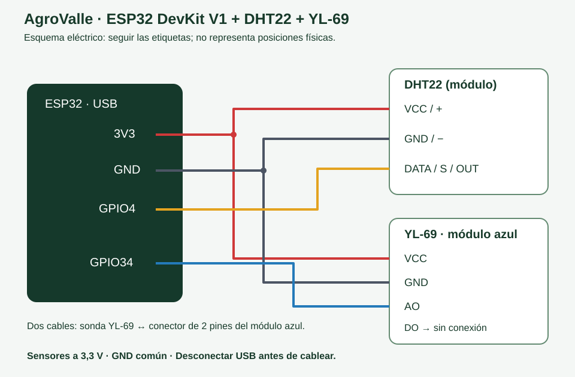

# ESP32 DevKit V1 + DHT22 + YL-69

## Conexion fisica exacta

Con el USB desconectado, une los pines segun su **etiqueta impresa**, no segun
el color del cable o la orientacion de una fotografia. Este esquema representa
conexiones electricas, no la posicion fisica de las patillas en cada placa.



| ESP32 | Conexion |
|---|---|
| 3V3 | VCC / + del DHT22 y VCC del modulo azul YL-69 |
| GND | GND / - del DHT22 y GND del modulo azul YL-69 |
| GPIO4 (IO4 / D4) | DATA / OUT / S del DHT22 |
| GPIO34 (IO34 / D34) | AO del modulo azul YL-69 |
| Sin conexion | DO del modulo azul YL-69 |

- Conserva los dos cables entre la sonda de suelo y el conector de dos pines del modulo azul.
- Todos los GND deben estar unidos. Puedes repartir 3V3 y GND en los rieles de una protoboard.
- Alimenta el ESP32 por USB. No conectes los sensores a VIN/5V; sus senales deben ser de 3,3 V.
- El DHT22 de tres terminales mostrado es un modulo; normalmente ya tiene pull-up. Si su DATA no tiene resistencia, agrega 4,7–10 kohm entre DATA y 3V3.
- No conectamos rele ni bomba. El firmware omite bomba_encendida y conserva el estado previo almacenado.
- Solo la parte de la sonda prevista para suelo entra en el sustrato. Mantener secos modulo azul, conectores, DHT y ESP32.
- El YL-69 es resistivo y se degrada energizado continuamente. Este cableado es para pruebas breves supervisadas; para funcionamiento permanente conviene conmutar su alimentacion con un transistor o usar una sonda capacitiva. No alimentar el modulo directamente desde un GPIO.

## Flujo

ESP32 --HTTPS--> POST /api/telemetria en Render --RPC--> Supabase.
Cada nueva fila genera el webhook INSERT ya configurado. Usar ALERT_TRIGGER=webhook
para tener una sola fuente de alertas. El frontend consulta /api/estado.

No hay claves de Supabase ni de Resend en el ESP32. No enviar directamente a
/rest/v1/telemetria: ese camino omite la comparacion atomica de cambios.

## Preparacion del backend (antes del envio fisico)

La correccion local exige un token exclusivo en POST /api/telemetria:

```dotenv
TELEMETRIA_API_TOKEN=RELLENAR_CON_TOKEN_ALEATORIO_DE_64_CARACTERES_HEXADECIMALES
DISPOSITIVO_ID=ESP32-AGRO-01
PLANTA_NOMBRE=Mi planta
ALERT_TRIGGER=webhook
```

Generar un token con un gestor de contrasenas o, en una terminal privada:

```powershell
node -e "console.log(require('node:crypto').randomBytes(32).toString('hex'))"
```

No compartir la salida, guardarla en capturas o subirla a Git. Configurar manualmente
el mismo token en Render y config.h. No reutilizar SUPABASE_WEBHOOK_SECRET ni el JWT
de login. Este cambio requiere revisar/publicar el backend; no se ha desplegado
automaticamente. Configurar la variable ANTES del despliegue evita rechazos por falta
de token. Actualizar cualquier otro emisor existente: ahora necesitara Bearer.

La migracion SQL ya fue aplicada por el usuario. No hace falta repetirla ni editar filas.
SUPABASE_KEY en Render debe ser una clave de servidor con rol service_role
(JWT service_role o secret key de servidor), porque el RPC solo permite ese rol.
Una clave anon/publishable no tiene permiso para ejecutar esta funcion. Verificar
el tipo sin compartir su valor; nunca colocar la clave de servidor en el ESP32 o Vite.
No cambiar Resend, destinatarios o el webhook existente para instalar el firmware.

## Arduino IDE

1. Instalar Arduino IDE 2 y el paquete **esp32 by Espressif Systems** (version validada abajo).
   URL adicional de placas: https://espressif.github.io/arduino-esp32/package_esp32_index.json
2. Seleccionar **ESP32 Dev Module**, flash 4 MB y el puerto COM del dispositivo.
   Es compatible con el ESP-WROOM-32 del DevKit V1. Si falla la carga, mantener BOOT
   mientras aparece Connecting y soltar cuando empiece la escritura.
3. Instalar bibliotecas: **DHT sensor library by Adafruit**, **Adafruit Unified Sensor**
   y **ArduinoJson by Benoit Blanchon (version 7)**.
4. Abrir agrovalle_esp32/agrovalle_esp32.ino. Copiar config.example.h como config.h
   si aun no existe. Rellenar SSID, password y TELEMETRIA_TOKEN solo en config.h.
5. Mantener API_URL con HTTPS y DISPOSITIVO_ID igual que en Render.
   WiFi debe ser una red de 2,4 GHz compatible con este ESP32, sin portal cautivo.
6. Cargar por USB y abrir Monitor serie a **115200 baudios**. Puede enviarse cada comando
   como una letra con o sin salto de linea.
   Si no aparece un COM, revisar que el cable USB transmita datos y el controlador
   USB del modelo de placa (CP210x o CH340, segun el chip que realmente incluya).

Alternativa en este equipo: las herramientas de comprobacion estan instaladas en
`.local/arduino-tools`, fuera de los repositorios. Tras completar config.h se puede
compilar/cargar desde PowerShell, situado en la carpeta Agrovalle, sin repetir esa
descarga en Arduino IDE. Primero obtener el puerto:

```powershell
.\.local\arduino-tools\arduino-cli.exe board list --config-file .local/arduino-tools/arduino.yaml
```

Luego sustituir COM5 por el puerto real y ejecutar (esto SI carga el ESP32):

```powershell
.\.local\arduino-tools\arduino-cli.exe compile --fqbn esp32:esp32:esp32 --jobs 2 --config-file .local/arduino-tools/arduino.yaml --build-path .local/esp32-build --upload --port COM5 backend/firmware/agrovalle_esp32
```

El firmware vuelve a compilarse con la configuracion privada. No usar los binarios
de comprobacion con placeholders como si ya tuvieran WiFi y token configurados.
Abrir el monitor serie despues de cargar (usar el mismo puerto real):

```powershell
.\.local\arduino-tools\arduino-cli.exe monitor --port COM5 --config baudrate=115200 --config-file .local/arduino-tools/arduino.yaml
```

Cerrar el monitor antes de volver a cargar otro programa.

## Calibracion y primera prueba

Al arrancar **no se envian mediciones**. Primero muestra ADC bruto y temperatura
cada 30 segundos; el porcentaje sera nan hasta terminar la calibracion.

1. Colocar la sonda en el sustrato seco de referencia, esperar a estabilizar y enviar **s**.
2. Colocarla a la misma profundidad en el mismo tipo de sustrato bien humedecido y
   drenado, esperar y enviar **h**. No sumergir la electronica.
3. La diferencia debe ser al menos 200 unidades ADC; si no, revisar conexiones/contacto.
   Los valores se guardan en la memoria del ESP32 y funcionan con ambas orientaciones
   de escala del modulo. Se pueden recalibrar estando detenido.
4. Revisar que la temperatura sea valida. Para comprobar almacenamiento sin provocar
   alertas, empezar con una temperatura real <30 C y humedad de suelo >=30%.
5. Enviar **e** para habilitar envios REALES; cada 30 segundos medira y enviara.
   Temperaturas >=30 C o humedad de suelo <30% pueden generar correos reales al cruzar el umbral. No hacer esa
   prueba sin autorizar previamente el correo.
6. Enviar **x** para detener. Reiniciar tambien arranca con los envios detenidos.
   Un POST que ya esta ejecutandose no puede cancelarse con x hasta que termine.

Mensajes esperados:

- HTTP 200: cambio registrado en Supabase -> nueva fila y fecha del servidor.
- HTTP 200: sin cambios -> ninguna fila adicional; no es un fallo.
- 401 -> token diferente/ausente; el envio queda pausado.
- 409 -> DISPOSITIVO_ID distinto; el envio queda pausado.
- 503 -> revisar variable del token, migracion, Supabase activo y logs seguros de Render.
- Codigo negativo -> red/TLS/timeout; revisar WiFi, NTP, CA y disponibilidad de Render.

El DHT aporta temperatura del aire. El porcentaje enviado en humedad proviene del
YL-69, NO de dht.readHumidity(). Es una escala relativa seco/humedo, no contenido
volumetrico de agua. Se promedian 32 muestras ADC, se redondea suelo a entero y
temperatura a una decimal. Las fluctuaciones resultantes pueden crear logs.
Los datos historicos anteriores no se reclasifican ni corrigen automaticamente:
si antes humedad significaba aire, no mezclar ese tramo con suelo en futuros promedios.

Se omiten lecturas invalidas. Hay reintentos con pausa creciente hasta 5 minutos
ante errores temporales. Se conserva en RAM un unico JSON pendiente, y se reintenta
sin cambiarlo antes del siguiente; no hay cola persistente durante cortes/reinicios.
fecha_hora indica el momento de registro en el servidor; una medicion reintentada
puede haberse tomado antes. No se inventan fechas locales durante cortes.
El RPC evita repetir filas consecutivas identicas; no es una garantia universal de
exactly-once si hay otro emisor intercalando datos. Usar este ESP como unico emisor.

## HTTPS y limites de seguridad

Se sincroniza la hora por NTP y se valida el certificado de Render con GTS Root R4
(CA publica incluida en certificado_ca.h). La cadena observada en una conexion TLS
verificada a este host fue onrender.com -> WE1 -> GTS Root R4. Si Render cambia de CA,
actualizar ese archivo desde una fuente confiable; no desactivar TLS.
El token estatico es para este prototipo y puede extraerse de un dispositivo con
acceso fisico. No imprimirlo ni habilitar logs HTTP detallados.

Fuentes: [cliente TLS Espressif](https://github.com/espressif/arduino-esp32/blob/master/libraries/NetworkClientSecure/README.md),
[ADC1 y WiFi](https://docs.espressif.com/projects/esp-hardware-design-guidelines/en/latest/esp32/schematic-checklist.html),
[biblioteca DHT](https://github.com/adafruit/DHT-sensor-library).

## Validacion

Compilacion real en Windows aprobada con **esp32 by Espressif Systems 3.3.8**,
placa `esp32:esp32:esp32` (ESP32 Dev Module), DHT sensor library 1.4.6,
Adafruit Unified Sensor 1.1.15 y ArduinoJson 7.4.2. Ocupa **1.059.092 bytes (80%)**
de flash de aplicacion y **48.552 bytes (14%)** de RAM estatica. Esto no mide el
consumo dinamico durante TLS ni valida los sensores fisicos. Se compilo con valores
de configuracion de ejemplo, sin cargar la placa.

Pruebas del backend: **48 aprobadas**, con Supabase/Resend/SMTP simulados. Incluyen
rechazo sin token, token equivocado y secreto de webhook, y guardado con token valido.
No se ejecutaron envios fisicos, escrituras remotas ni correos reales desde este entorno.
La lectura electrica y calibracion deben comprobarse con el hardware conectado.
